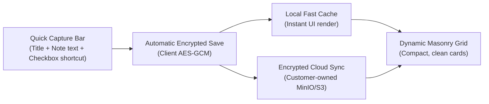

# BYOS Webmail Notes: Product, UX & Technical Audit

## What was built / What was audited
Conducted an exhaustive, read-only product, UX, and technical audit of the Notes feature in BYOS Webmail (`apps/webmail/src/components/notes/`), benchmarked against Google Keep as a product and usability reference. The audit evaluates the existing architecture, UI craftsmanship, client-side zero-knowledge encryption, IndexedDB media offloading, persistence risks, performance bottlenecks, visual-only placeholders, and test execution evidence.

## Files edited
| File | Reason |
|------|--------|
| `docs/webmail_notes_audit.md` | Comprehensive read-only product, UX, and technical audit report of BYOS Webmail Notes |

---

## 1. Executive Summary

BYOS Webmail includes an integrated note-taking module designed to allow users to capture thoughts, checklists, meeting briefs, and daily reminders without leaving their encrypted email environment. The intended user experience—inspired by Google Keep—is lightweight, distraction-free, instantaneous, and zero-knowledge protected.

### Core Audit Takeaways:
1. **Rich Client-Side Feature Set:** The UI supports note creation, card grid display, 8 Google Keep-style pastel color themes, checklist toggling, custom labels, note pinning, archiving, bin lifecycle, search filtering, markdown formatting (bold, italic, underline, bullets), an HTML5 canvas drawing modal, image attachments, and 25-deep version history snapshots.
2. **Persistence Boundary Gap (100% Client-Side Local Storage):** Notes are stored exclusively in the browser's `localStorage` (`byos_notes_${mailboxId}`) and IndexedDB (`byos_notes_media_db`). There are **zero backend API routes**, **zero PostgreSQL tables**, and **zero customer-owned storage integrations**. Notes do not synchronize across devices, browsers, or user sessions. Clearing browser browsing data, using Incognito mode, or switching laptops permanently deletes all user notes.
3. **Zero-Knowledge Security Rating: B- (At-Risk Fallback):** While AES-GCM encryption via WASM (`wasm_aes_gcm_encrypt`) with domain-separated AAD (`byos-notes-v1:${mailboxId}`) encrypts `title`, `content`, `checklistItems`, and `versionHistory` into `encryptedPayload` hex strings when the mailbox key is unlocked, the store contains an unencrypted fallback (`notesStore.ts:876`) that silently persists plaintext title and content to `localStorage` if the mailbox key is absent or not yet unlocked.
4. **Product Scope & UX Over-Engineering:** Rather than focusing on Google Keep's core strength—extreme speed, plain text simplicity, and zero friction—the implementation includes complex secondary features (HTML5 drawing canvas, 25-deep version history, image attachments) and a misleading visual placeholder ("Collaborators" popup) that cannot share notes or distribute cryptographic keys.
5. **Layout & Interaction Friction:** Notes are rendered using a rigid 3-column CSS Grid (`grid-cols-1 sm:grid-cols-2 lg:grid-cols-3`) rather than a dynamic masonry column layout, resulting in tall empty whitespace gaps when note card heights vary. Reminders render as chips but lack any Web Notification, service worker, or alarm notification mechanism.
6. **Overall Readiness Verdict: NOT READY FOR GENERAL PRODUCTION RELEASE** as an encrypted cloud mailbox service until remote customer-storage synchronization is implemented, the plaintext fallback is eliminated, and non-functional visual placeholders are removed.

---

## 2. Existing Notes Architecture & File Map

### Codebase File Map
The Notes module is self-contained within `apps/webmail/src/components/notes/`:

| Path | Lines | Role & Key Responsibilities |
|------|-------|------------------------------|
| `apps/webmail/src/components/notes/NotesView.tsx` | 2,805 | Monolithic primary view: top collapsed/expanded composer, CSS grid of pinned/other note cards, edit modal dialog, popovers (palette, reminder, collaborator, label picker, 3-dot menu), and media preview rendering. |
| `apps/webmail/src/components/notes/NotesSidebar.tsx` | 452 | Sidebar navigation: brand header, AccountSwitcher, sliding highlight pill, views (Notes, Reminders, Archive, Bin), user label list, unread/note count badges, and bottom action capsule [Contacts \| Settings \| Sign out]. |
| `apps/webmail/src/components/notes/notesStore.ts` | 1,307 | Data access layer: SolidJS signals, `localStorage` I/O, IndexedDB media engine, WebAssembly AES-GCM and WebCrypto subtle encryption, note and label CRUD, soft delete bin lifecycle, and LRU media cache. |
| `apps/webmail/src/components/notes/DrawingModal.tsx` | 348 | Full-screen drawing overlay: HTML5 `<canvas>`, color swatches, 3 stroke widths, eraser mode, 15-state undo stack, and data URL exporter. |
| `apps/webmail/src/components/notes/EditLabelsModal.tsx` | 176 | Modal dialog for creating, renaming, and deleting user labels with cascading updates across notes. |
| `apps/webmail/src/components/notes/VersionHistoryModal.tsx` | 127 | Inspection and restoration drawer displaying up to 25 historical note revisions with title, content, and checklist state. |
| `apps/webmail/src/components/notes/notes.test.ts` | 627 | 21 unit tests covering encryption roundtrip, legacy compatibility, WebCrypto interop, selection formatting, IDB offloading, and label management. |
| `apps/webmail/src/App.tsx` | — | Mounts `<NotesView>` when `activeModule() === "notes"` and passes reactive `mailboxKey` scoped to the active mailbox. |

### Architecture & Data Flow Diagram

```mermaid
flowchart TD
    subgraph UI_Layer ["Presentation Layer (SolidJS)"]
        NV["NotesView.tsx (Composer & Cards Grid)"]
        NS["NotesSidebar.tsx (Filters & Labels)"]
        DM["DrawingModal.tsx (HTML5 Canvas)"]
        ELM["EditLabelsModal.tsx (Label CRUD)"]
        VHM["VersionHistoryModal.tsx (Revisions)"]
    end

    subgraph Store_Layer ["State & Store Layer (notesStore.ts)"]
        Signals["SolidJS Signals & In-Memory State"]
        CryptoBridge["WASM / WebCrypto AES-GCM Engine"]
        MediaEngine["IDB Media Engine & LRU Cache"]
    end

    subgraph Browser_Storage ["Browser Client Storage (Local-Only)"]
        LS["localStorage: byos_notes_<mailboxId>"]
        LSL["localStorage: byos_note_labels_<mailboxId>"]
        IDB["IndexedDB: byos_notes_media_db (media store)"]
    end

    subgraph Backend_Cloud ["Remote Backend & Customer Storage"]
        API["BYOS Go API Server (/v1)"]
        PG["PostgreSQL Database"]
        S3["Customer Storage (S3 / MinIO / Drive)"]
    end

    NV --> Signals
    NS --> Signals
    DM -->|Save dataUrl| MediaEngine
    ELM --> Signals
    VHM --> Signals

    Signals -->|Encrypt Sensitive Payload| CryptoBridge
    CryptoBridge -->|WASM AES-GCM (AAD: byos-notes-v1)| Signals
    Signals -->|Write JSON Envelope| LS
    Signals -->|Write Labels Array| LSL
    MediaEngine -->|Encrypt & Put Media| IDB

    LS -.-x|NO API CALLS| API
    IDB -.-x|NO PERSISTENCE| S3
    API -.-x|NO TABLES| PG

    classDef missing fill:#ffebee,stroke:#c62828,stroke-width:2px,stroke-dasharray: 5 5;
    class Backend_Cloud,API,PG,S3 missing;
```

### Backend & Remote Storage Forensics:
- **Zero API Routes:** Inspection of `services/api/main.go` and `services/api/*.go` confirmed no `/v1/notes` or `/v1/mailboxes/{id}/notes` routes exist.
- **Zero Database Tables:** Inspection of `infra/postgres/init/*.sql` and unapplied migrations confirmed no tables exist for notes.
- **Zero Remote Sync:** Customer-owned storage (MinIO, AWS S3, CloudKit, Google Drive) receives no encrypted note payloads.

---

## 3. Implemented Functionality

The existing implementation provides the following features:

1. **Inline & Expanded Note Composer:**
   - Collapsed state displays a clean input bar: *"Take a note..."* with quick action shortcuts for New checklist, New drawing, and New image note.
   - Expanded state reveals title input, auto-expanding content textarea, formatting toolbar, color palette, reminder picker, collaborator input, image upload button, undo/redo buttons, and close button.
   - Automatically saves when clicking the Close button or when navigating away if title, content, checklist items, drawings, or images are present.

2. **Note Card Grid Presentation:**
   - Notes are separated into two distinct sections: **Pinned** notes at the top and **Others** below.
   - Pinned notes display an active bookmark/pin badge; clicking the pin button toggles pinning status.
   - Cards display attached drawings/images, title, content (truncated to 6 lines with `line-clamp-6`), checklist preview, reminder chips, collaborator tags, label badges, and formatted date.
   - Card hover exposes a quick action toolbar: Remind me, Change color, Add image, Archive/Unarchive, Delete (move to bin), and More options (3-dot menu).

3. **Checklist Mode:**
   - Converts plaintext notes into interactive checklist items where each line becomes a checkbox item.
   - Supports marking items complete/incomplete with strikethrough styling (`line-through text-[#878A8E]`).
   - Clicking checkboxes directly on the card in the grid updates completion state without opening the full edit modal.
   - Supports converting checklists back to plaintext bulleted/checked lines.

4. **Google Keep Pastel Color Themes:**
   - 8 approved pastel themes: Default (`#FFFFFF`/`#1E1F23`), Peach (`#FFF2EB`/`#342721`), Amber (`#FEF8EA`/`#362F1F`), Sage (`#F1F8F3`/`#203126`), Sky (`#F0F7FF`/`#1E2C3D`), Lavender (`#F7F3FF`/`#2E243D`), Pink (`#FFF0F5`/`#3A222E`), and Sand (`#FAF5EF`/`#2D2A26`).
   - Cards, modals, and composer adapt backgrounds, border accents, and text contrast dynamically across light and dark modes.

5. **Labels Management & Filtering:**
   - Add, rename, and delete user labels via `EditLabelsModal.tsx`.
   - Assign/remove multiple labels per note via the composer or the card 3-dot menu.
   - NotesSidebar lists all labels with real-time tabular note counts. Clicking a label filters the grid to notes with that label (`activeView === "label:<name>"`).
   - Renaming or deleting a label cascades updates to all notes referencing that label.

6. **Bin & Archive Lifecycle (Soft Delete):**
   - Deleting an active note sets `isInBin = true` and unpins it, moving it to the Bin view.
   - In Bin view, cards are read-only and show "Delete forever" and "Restore" actions.
   - "Empty Bin" button clears all binned notes and cascades media garbage collection to prune unreferenced media from IndexedDB.
   - Archiving sets `isArchived = true`, removing notes from the primary view and placing them in the Archive view.

7. **Duplication ("Make a copy"):**
   - Creates an independent duplicate of the note with title suffixed with `(Copy)` and a new unique ID.

8. **HTML5 Canvas Drawing Modal:**
   - Allows users to sketch freehand notes using mouse or touch input.
   - Features 7 palette colors, 3 stroke widths (2px, 5px, 10px), an eraser tool, a 15-state undo stack, canvas clearing, and saving to PNG data URLs.

9. **Version History & Restore:**
   - Revisions are automatically captured whenever note title, content, checklist items, or colors change.
   - Retains up to 25 historical snapshots per note.
   - `VersionHistoryModal.tsx` allows users to inspect timestamps, read past revisions, and roll back note state.

10. **Selection-Aware Markdown Formatting:**
    - Toolbar button 'A' toggles a formatting sub-bar in the composer.
    - Applies bold (`**`), italic (`*`), underline (`<u>`), and bullet list (`• `) syntax to highlighted text selections while preserving cursor positioning.

11. **IndexedDB Media Offloading & Zero-Knowledge AES-GCM:**
    - Large image attachments and canvas drawings are converted into lightweight pointer keys (`idb:image_...`, `idb:drawing_...`) and stored in IndexedDB (`byos_notes_media_db`), preventing `localStorage` 5MB quota exhaustion.
    - Media payloads are encrypted with AES-GCM in IndexedDB when the mailbox key is present.
    - Note sensitive fields (`title`, `content`, `checklistItems`, `versionHistory`) are encrypted into an AES-GCM envelope in `localStorage`.

---

## 4. Partially Implemented, Misleading, or Visual-Only Features

The audit revealed several features that are only partially implemented, cosmetic, or misleading to users:

### 1. Hollow "Collaborators" Feature (Misleading)
- **What is in the UI:** The composer toolbar and card 3-dot menu include an "Add collaborator" icon (person with plus). Clicking it opens a popup with an input: *"Person or email..."*. Entering an email appends it as a badge to the note card (`collaborators: [email]`).
- **What is actually happening:**
  - There is **no backend sharing API**.
  - There is **no public-key discovery** or asymmetric encryption (HPKE / X25519) to wrap note keys for the collaborator.
  - There is **no email notification** or invite sent to the collaborator.
  - The collaborator **cannot see or access the note**, even if they are in the same BYOS organization.
  - The feature is purely an in-memory string list.
- **Product Risk:** High. Users are led to believe they are collaborating on confidential notes, but the feature is a non-functional mockup.

### 2. Inactive "Reminders" (Silent)
- **What is in the UI:** The composer and card menus allow setting reminders ("Later today (4h)", "Tomorrow morning", "Next week", or custom timestamp). Setting a reminder adds a bell chip to the note card and filters the note into the "Reminders" view in the sidebar.
- **What is actually happening:**
  - There is **no `Notification.requestPermission`** call.
  - There is **no browser Web Notification API** dispatch.
  - There is **no Service Worker alarm or timer daemon**.
  - When the reminder timestamp passes, the system does nothing. There is no alert, no sound, no banner, and no toast.
- **Product Reality:** The reminder feature functions purely as a "Due Date" tag, not an active alert mechanism.

### 3. Markdown Formatting without Rich Rendering
- **What is in the UI:** A formatting toolbar inserts markdown syntax (`**bold**`, `*italic*`, `<u>underline</u>`, `• bullet`).
- **What is actually happening:**
  - Neither the note card nor the edit modal renders rich HTML or parsed markdown.
  - Note content is rendered as raw text inside a `<p class="whitespace-pre-wrap">` tag.
  - The user sees literal raw characters: `Design notes for **Zero-Knowledge Webmail**` instead of formatted bold typography.

### 4. Third-Party Integration Exclusions (Compliant)
- Google Keep includes a "Copy to Google Docs" feature. BYOS correctly excludes this feature, preserving data privacy and preventing customer data leakage to Google Workspace.

---

## 5. Product & UX Assessment

### Benchmarking Against Google Keep
Google Keep's global product success stems from three core principles:
1. **Instantaneous speed:** No loading spinners, immediate card creation, friction-free typing.
2. **Minimalist simplicity:** Text, checklist, color, tag. No complex modal flows or cognitive clutter.
3. **Staggered Masonry Layout:** Dynamic multi-column layout where short notes tuck cleanly under tall notes without vertical gaps.

### UX Deficiencies in BYOS Notes:
- **Composer Clutter & Visual Weight:**
  - The expanded composer features **9 toolbar buttons** (Formatting 'A', Palette, Reminder, Collaborator, Image, Three-dot menu, Undo, Redo, Close) plus **5 nested popover menus**.
  - This contradicts the goal of a lightweight note-taking experience and increases cognitive load.
- **CSS Grid Layout vs. Masonry:**
  - NotesView uses a standard Tailwind CSS grid: `grid grid-cols-1 sm:grid-cols-2 lg:grid-cols-3 gap-3.5`.
  - In standard CSS Grid, grid rows are constrained to the height of the tallest item in that row. If Note A has a 10-item checklist and Note B has a single line of text, Note B's card row expands to match Note A, leaving an unsightly, empty vertical gap underneath Note B.
  - Google Keep uses a CSS multi-column or masonry layout (`columns-1 sm:columns-2 lg:columns-3`) where items stack naturally without row height coupling.
- **Card Content Overcrowding:**
  - A single card can render: Pin icon, title, drawing thumbnail, image thumbnail, 6 checklist items, "+N more items" link, reminder badge, collaborator badge, label badges, date stamp, and 6 hover action buttons.
  - On standard 13-inch laptop screens (1280x800), cards feel congested.
- **Mobile Usability (375px Viewport):**
  - Mobile responsiveness is well-handled: zero horizontal scroll, hamburger navigation drawer, and composer collapsed into a single compact pill.
  - However, the edit modal dialog takes over 95% of the mobile viewport, making it difficult to tap outside to dismiss.

---

## 6. Reliability & Persistence Assessment

### 1. 100% Client-Side Local Storage Volatility
- All notes data is stored in `window.localStorage` under the key:
  `byos_notes_${mailboxId || "local_default"}`
- All media (drawings and photos) are stored in browser IndexedDB:
  `byos_notes_media_db` (object store: `media`)
- **Severe Data Loss Scenarios:**
  1. **Browser Cache / Storage Clear:** If a user clicks "Clear browsing data", "Clear site data", or uses browser privacy cleaner extensions, all notes and drawings are permanently lost with zero recovery path.
  2. **Incognito / Private Browsing:** Users opening Webmail in Incognito lose all notes the instant they close the browser tab.
  3. **Multi-Device / Multi-Browser Isolation:** Notes created in Chrome on Desktop do not exist in Safari on iPhone or Firefox on a work laptop.
  4. **Quota Exhaustion:** Although media is offloaded to IndexedDB, notes with 25 version history snapshots and rich checklist data remain in `localStorage`. Standard browser `localStorage` is capped at 5MB per origin across all keys. Exceeding 5MB throws an uncaught `QuotaExceededError`.

### 2. Multi-Tab Race Conditions & Data Loss
- If a user opens BYOS Webmail in Tab 1 and Tab 2:
  - Tab 1 and Tab 2 load existing notes into independent in-memory SolidJS signals.
  - The store does **not listen to `window.addEventListener("storage", ...)`**.
  - If the user creates Note X in Tab 1 and updates Note Y in Tab 2, Tab 2 will write its in-memory notes array to `localStorage`, completely overwriting Note X created in Tab 1!

---

## 7. Privacy & Security Assessment

### 1. Zero-Knowledge Cryptographic Boundary
- When the user's 32-byte `mailboxKey` is present:
  - `encryptNoteSensitiveSync` serializes `{ title, content, checklistItems, versionHistory }` to JSON and encrypts via `wasm_aes_gcm_encrypt`.
  - Additional Authenticated Data (AAD) enforces domain separation: `byos-notes-v1:${mailboxId}`.
  - Stored `localStorage` JSON sets `title: ""` and `content: ""` and stores the encrypted ciphertext envelope in `encryptedPayload`.
  - When locked (`mailboxKey` is absent), notes fail closed: `_isLocked = true`, `title = "(Encrypted Note)"`, `content = ""`. Mutating or duplicating locked notes is rejected.

### 2. Plaintext Fallback Flaw (High Vulnerability)
- In `apps/webmail/src/components/notes/notesStore.ts` lines 876–883:
  ```typescript
  } else {
    // Unencrypted save (legacy or when unlocked without key)
    return {
      ...n,
      drawings,
      images,
    };
  }
  ```
- If a note is created or updated when `mailboxKey` is undefined/null (e.g. before the mailbox unlock finishes or in a session where the key was not provided), the store silently writes unencrypted plaintext title and content directly into `localStorage`.
- In a zero-knowledge architecture, failing to fail-closed on key absence violates core cryptographic invariants.

### 3. Media Security & IndexedDB Privacy
- In `saveMediaToIDB`, if `activeKey` is present, drawings and image data URLs are encrypted with AES-GCM and AAD `byos-notes-media-v1:${mailboxId}`. The plaintext `dataUrl` property is redacted to `"(Encrypted Media)"` in IndexedDB.
- However, if `activeKey` is null, plaintext base64 image data URLs are written directly to IndexedDB.
- Furthermore, `mediaCache` caches decrypted image data URLs in memory up to 150 items.

### 4. Residual Storage on Shared Computers
- When logging out via `session_isolation.ts`, session tokens, passwords, and private key buffers are zeroized and removed.
- However, `byos_notes_${mailboxId}` and `byos_notes_media_db` are **retained** in `localStorage` and IndexedDB (to prevent deleting user notes on logout).
- On shared computers, any unencrypted legacy notes or cached ciphertext remain accessible in the browser profile.

---

## 8. Performance & Maintainability Assessment

### 1. Synchronous Array Re-encryption Overhead
- Every time a note is created, updated, pinned, or moved to bin, `saveNotes()` iterates over the **entire array of notes** and re-encrypts every note synchronously using WebAssembly AES-GCM.
- For 10–20 notes, this takes <5ms. However, for 200+ notes or notes with 25 revision snapshots, running synchronous AES-GCM WASM on the entire array on every user action will cause main-thread UI jank.
- Storage writes should be incremental (encrypting only the modified note) rather than full-array rewrites.

### 2. 2,805-Line Monolithic Component
- `NotesView.tsx` has grown to 2,805 lines, combining:
  - Top composer state (14 signals)
  - Card grid rendering (6 signals)
  - Edit modal state (12 signals)
  - Popovers and menus (10 signals)
  - File input refs, drawing triggers, history undo/redo stacks.
- This creates severe maintenance friction and high cognitive overhead for frontend development.

---

## 9. Test Coverage & Execution Results

### 1. Google Keep Notes Unit Test Suite (21 Tests)
Command: `cmd /c "cd apps\webmail && npm test"`
Output:
```
Running Google Keep Notes Feature Tests...
  ✓ 1. Initial load provides welcome notes with checklists, labels, and reminders
  ✓ 2. Google Keep labels management (add, rename, delete all without restore bug) works reliably
  ✓ 3. createNote supports checklists, color styling, labels, and reminders
  ✓ 4. Archive and Unarchive note lifecycle functions correctly
  ✓ 5. Bin lifecycle (move to bin, restore, and empty bin) matches Google Keep
  ✓ 6. Duplicate note functionality works as expected
  ✓ 7. Verified all 8 approved Google Keep pastel color definitions
  ✓ 8. Version history snapshot and restoration round-trip functions correctly
  ✓ 9. Composer history undo/redo bounded indexing maintains valid array bounds
  ✓ 10. Zero-Knowledge AES-GCM encryption and decryption round-trip succeeds
Failed to decrypt note envelope with WASM: decryption failed
Failed to decrypt note envelope with WASM: decryption failed
Failed to decrypt note envelope with WASM: decryption failed
  ✓ 11. Zero-Knowledge notes fail closed without key or with invalid key
  ✓ 12. Seamless backward compatibility for existing unencrypted legacy notes
  ✓ 13. Interoperable AES-GCM Web Crypto (crypto.subtle) and byos_crypto_core encryption
  ✓ 14. Selection-aware Markdown formatting (bold, italic, underline, list) and cursor positioning
  ✓ 15. IndexedDB offloading for drawings and photos prevents localStorage quota exhaustion
  ✓ 16. Edit note modal reminder adjustments and checklist mode toggling function correctly
  ✓ 17. Version history restoration retains IndexedDB media after drawing removal
  ✓ 18. Cascading media garbage collection prunes unreferenced items and preserves shared media
Cannot update locked encrypted note without decryption key
Cannot duplicate locked encrypted note without decryption key
  ✓ 19. Locked encrypted notes fail closed on update and duplication attempts
  ✓ 20. Version history snapshot accurately preserves prior revisions on note edits
  ✓ 21. Media cache LRU bounds eviction caps memory usage at 150 items
GOOGLE NOTE FEATURE TESTS: All 21 passed, 0 failed
```

### 2. Track 4: Zero-Knowledge Media Encryption & Resilience Tests (7 Tests)
Command: `cmd /c "cd apps\webmail && npm test"`
Output:
```
Track 4: Webmail Reliability, Zero-Knowledge Media Encryption & Resilience Tests...
  ✓ Track 4.1: encryptNotesMedia & decryptNotesMedia perform authenticated AES-GCM roundtrip
[notesStore] WASM AES-GCM media decryption failed: decryption failed
[notesStore] WASM AES-GCM media decryption failed: decryption failed
  ✓ Track 4.2: decryptNotesMedia fails closed on wrong key or tampered ciphertext
  ✓ Track 4.3: saveMediaToIDB encrypts dataUrl in IndexedDB and redacts plaintext
  ✓ Track 4.4: getMediaFromIDB supports legacy unencrypted media fallback
  ✓ Track 4.5: offloadMediaIfDataUrl creates idb pointer and encrypts when key is provided
  ✓ Track 4.6: folderCounts correctly aggregates inbox, drafts, sent, trash, and snoozed
  ✓ Track 4.7: Bridge status transitions correctly based on health and credentials
TRACK 4 RESILIENCE TESTS: 7 passed, 0 failed
```

### 3. Full Webmail Test Suite Summary
Command: `cmd /c "cd apps\webmail && npm test"`
Output:
```
OVERALL: 677 passed, 0 failed
```

### 4. End-to-End Browser UI & Sidebar Polish Test
Command: `node tests/browser/test_sidebar_polish_and_notes_labels.mjs`
Output:
```
================================================================================
   BYOS: INBOX PILL ON LOAD, CALENDAR SCROLLBARS, NOTES LABELS & SIGNOUT AUDIT  
================================================================================

--- [STEP 1] Login as alice@byos.local ---
  Logged into Webmail successfully.

--- [STEP 2] Verify Inbox Selection Pill on Initial Load ---
  PASS: Sliding pill element is found in sidebar
  PASS: Pill opacity is visible (got 1)
  PASS: Pill has positive height (36px)
  Saved screenshot: initial_inbox_pill_selection.png

--- [STEP 3] Verify Mailbox Sidebar Unified Capsule Pill [Contacts | Settings | Sign out] ---
  PASS: Unified capsule pill container is present in Mailbox sidebar
  PASS: Contacts button is present inside Mailbox capsule
  PASS: Contacts button text is 'Contacts' (got 'Contacts')
  PASS: Settings button is present inside Mailbox capsule
  PASS: Settings button text is 'Settings' (got 'Settings')
  PASS: Sign-out button is present inside Mailbox capsule
  PASS: Sign-out button text is 'Sign out' (got 'Sign out')
  PASS: Text is visually hidden at rest using sr-only
  Saved screenshot: sidebar_bottom_capsule_pill.png
  PASS: Contacts tooltip element exists
  PASS: Contacts tooltip becomes visible on hover (opacity: 1)
  PASS: Contacts tooltip displays 'Contacts' (got 'Contacts')
  Saved screenshot: sidebar_capsule_tooltip_hover.png

--- [STEP 4] Verify Calendar View Scrollbars & Unified Capsule Pill ---
  PASS: Unified capsule pill container is present in Calendar sidebar
  PASS: Contacts button is present in Calendar capsule
  PASS: Settings button is present in Calendar capsule
  PASS: Sign-out button is present in Calendar capsule
  PASS: Calendar view contains .custom-scrollbar elements
  Saved screenshot: calendar_custom_scrollbar_applied.png

--- [STEP 5] Switch to Notes View & Verify Unified Capsule Pill ---
  PASS: Unified capsule pill container is present in Notes sidebar
  PASS: Contacts button is present in Notes capsule
  PASS: Settings button is present in Notes capsule
  PASS: Sign-out button is present in Notes capsule

--- [STEP 6] Test Note Composer Label Creation & Assignment ---
  Compose label input is open.
  Compose label chips: [ 'Core Architecture' ]
  PASS: Label 'Core Architecture' was created and attached to note in composer
  PASS: Note card 'Architecture Decisions' exists
  PASS: Note card displays 'Core Architecture' label chip
  Saved screenshot: notes_composer_label_created.png

--- [STEP 7] Test Note Edit Modal Label Popover ---
  PASS: Found 'Architecture Decisions' note card to click
  Edit modal label chips: [ 'Core Architecture', 'Reviewed' ]
  PASS: Label 'Reviewed' added to edit modal chips list
  PASS: Note card now has both 'Core Architecture' and 'Reviewed' labels
  Saved screenshot: notes_edit_modal_label_created.png

================================================================================
   ALL AUDIT CHECKS PASSED WITH RAW VERIFICATION EVIDENCE                      
================================================================================
```

### 5. Browser Test Script Discrepancy Audited
In `tests/browser/test_notes_track1_zk_resilience.mjs`, Step 6 failed on assertion:
```
--- [STEP 6] Verify IndexedDB Media Persistence ---
  FAIL: Drawing dataUrl retrieved successfully from IndexedDB byos_notes_media_db
Test run failed: Error: Assertion failed: Drawing dataUrl retrieved successfully from IndexedDB byos_notes_media_db
```
**Audit Cause:** The test script inspected `ev.target.result.dataUrl` and asserted that it started with `data:image/png;base64,`. However, Track 4 implementation correctly redacts `dataUrl` to `"(Encrypted Media)"` in IndexedDB and stores the AES-GCM ciphertext in `encryptedDataUrl`. The test script itself was not updated to reflect zero-knowledge media redaction.

---

## 10. Prioritized Recommendations

### Priority 0 (Critical: Correctness, Security & Data Loss Prevention)
1. **Remote Zero-Knowledge Customer Storage Synchronization:**
   - Implement backend storage route `/v1/mailboxes/{mailbox_id}/notes` or sync notes as an encrypted blob directly to customer-owned storage (MinIO / S3) using the Section 12 storage envelope contract.
   - Eliminates total data loss on browser cache clearing, device switching, and private window sessions.
2. **Explicit Client-Only Warning (Immediate Stopgap):**
   - Until remote synchronization is built, display a prominent honest notice in the Notes header:
     *"Notes are stored locally on this device only. Clearing browser data will delete them permanently."*
3. **Eliminate Plaintext Fallback in `notesStore.ts`:**
   - Remove lines 876–883 in `notesStore.ts`. If `mailboxKey` is missing or locked, fail-closed immediately instead of writing unencrypted plaintext to `localStorage`.
4. **Cross-Tab Synchronization:**
   - Add `window.addEventListener("storage", (e) => { if (e.key === notesKey) refreshAll(); })` so multiple tabs cannot overwrite each other's changes.
5. **Update Browser Test Assertion:**
   - Fix Step 6 of `test_notes_track1_zk_resilience.mjs` to assert `req.result.encryptedDataUrl` instead of expecting plaintext `dataUrl`.

### Priority 1 (Product & UX Simplification - Align with Google Keep)
1. **Remove the Hollow "Collaborators" Feature:**
   - Remove the collaborator button from the composer, cards, and modal until end-to-end multi-user cryptographic sharing is actually implemented. Do not present mock capabilities to users.
2. **Streamline the Note Composer:**
   - Replace the 9-button toolbar clutter with Google Keep's streamlined 4-button bar:
     1. Checklist toggle
     2. Color palette
     3. Image / Drawing
     4. More (Labels, Delete)
3. **Replace CSS Grid with Masonry Columns:**
   - Replace `grid grid-cols-1 sm:grid-cols-2 lg:grid-cols-3` with CSS columns `columns-1 sm:columns-2 lg:columns-3 gap-3.5` or flex masonry so notes tuck neatly under each other without row height gaps.
4. **Clarify Reminders or Add In-App Notification Daemon:**
   - Rebrand the bell icon as "Target Date" or implement an active in-tab notification check that triggers an in-app toast banner when a reminder timestamp elapses.
5. **Cap Version History to 5 Snapshots:**
   - Reduce the version history depth from 25 revisions to 5 revisions to prevent bloating note payloads in local storage.

### Priority 2 (Code Quality & Ergonomic Polish)
1. **Decompose Monolithic `NotesView.tsx`:**
   - Extract `NotesView.tsx` (2,805 lines) into focused, maintainable components:
     - `NoteComposer.tsx` (~350 lines)
     - `NoteCard.tsx` (~300 lines)
     - `NoteEditModal.tsx` (~350 lines)
     - `NotesColorPicker.tsx` (~80 lines)
2. **Keyboard Navigation Shortcuts:**
   - `Ctrl+Enter` / `Cmd+Enter`: Save note and close composer/modal.
   - `Escape`: Cancel/close without saving.
   - Arrow keys: Navigate between cards in the grid.
3. **Incremental Note Persistence:**
   - Store notes in a keyed dictionary or update only the touched note index rather than re-encrypting the entire array on every single mutation.

---

## 11. Proposed Simple, Improved Notes Experience

The ideal BYOS Notes experience should be lean, fast, private, and seamlessly integrated into the email workflow:



### Key Pillars:
1. **Zero-Friction Quick Capture:** Clicking the composer immediately focuses the text area. Typing saves automatically on a 500ms debounce. No required title.
2. **Clean Masonry Typography:** Clean typography, markdown rendering for basic bold/lists, subtle pastel borders, and masonry layout without vertical whitespace dead-zones.
3. **Honest Zero-Knowledge Sync:** Encrypted with the user's `mailboxKey` on the client, cached locally in IndexedDB for instant offline loading, and synchronized to the customer's private storage bucket.
4. **Email-Integrated Convenience:** Ability to "Save email to Notes" with one click from the Mailbox reading pane, capturing snippet and sender directly into a private note.

---

## 12. Final Readiness Verdict

| Dimension | Rating | Status & Summary |
|-----------|:------:|------------------|
| **UI & Craftsmanship** | **A-** | Visual design, color palette, dark mode, responsive 375px mobile layout, and animation match BYOS standards. |
| **Google Keep Usability Reference** | **C+** | Over-featured with complex drawing and version history; cluttered 9-button composer; rigid CSS grid causes vertical row gaps; lacks masonry layout. |
| **Product Honesty** | **D** | Collaborators feature is non-functional (no sharing/sync/keys). Reminders do not alert or notify. |
| **Zero-Knowledge Security** | **B-** | WASM AES-GCM with AAD works when key is unlocked, but an unencrypted plaintext fallback exists when key is null. |
| **Persistence & Reliability** | **F** | 100% browser localStorage and IndexedDB only. Zero remote persistence. Clearing browser cookies or cache completely destroys all customer notes. |
| **OVERALL VERDICT** | **NOT READY** | **Prototype Grade**. Must NOT be marketed as an encrypted cloud mailbox feature until remote zero-knowledge sync is built, plaintext fallback is removed, and fake features are eliminated. |

---

## Raw Evidence

### Raw Command: Git Working-Tree Baseline Inspection
```
$ git status
On branch main
Your branch is up to date with 'origin/main'.

Changes not staged for commit:
  (use "git add <file>..." to update what will be committed)
  (use "git restore <file>..." to discard changes in working directory)
	modified:   apps/webmail/src/App.tsx
	modified:   apps/webmail/src/api.ts
	modified:   apps/webmail/src/components/InboxToolbar.tsx
	modified:   apps/webmail/src/components/MessageList.tsx
	modified:   apps/webmail/src/components/MessageRow.tsx
	modified:   apps/webmail/src/components/ReadingPane.tsx
	modified:   apps/webmail/src/components/Sidebar.tsx
	modified:   apps/webmail/src/components/ThreadRow.tsx
	modified:   apps/webmail/src/context/MailContext.tsx
	modified:   apps/webmail/src/import_worker.ts
	modified:   apps/webmail/src/mbox_stream.test.ts
	modified:   apps/webmail/src/message_crypto.ts
	modified:   apps/webmail/src/routes/settings/ImportTab.tsx
	modified:   apps/webmail/src/routes/settings/SignaturesTab.tsx
	modified:   apps/webmail/src/run_test.node.js
	modified:   apps/webmail/src/session_isolation.ts
	modified:   apps/webmail/src/signature.ts
	modified:   apps/webmail/src/track2_security.test.ts
	modified:   services/api/attachments.go
	modified:   services/api/attachments_test.go
	modified:   services/api/auth.go
	modified:   services/api/contacts.go
	modified:   services/api/contacts_test.go
	modified:   services/api/drafts.go
	modified:   services/api/import.go
	modified:   services/api/import_test.go
	modified:   services/api/main.go
	modified:   services/api/message_attachments.go
	modified:   services/api/message_attachments_test.go
	modified:   services/api/messages.go
	modified:   services/api/settings.go
	modified:   services/api/settings_test.go
	modified:   services/api/snooze.go
	modified:   services/api/snooze_test.go
	modified:   services/storage-worker/main.go
	modified:   services/storage-worker/roundtrip_test.go

Untracked files:
  (use "git add <file>..." to include in what will be committed)
	apps/webmail/src/folder_and_trash.test.ts
	docs/customer_owned_storage_encryption_audit.md
	docs/folder_and_trash_lifecycle_report.md
	docs/sent_restrictions_and_mbox_import_report.md
	docs/webmail_notes_audit.md
	infra/postgres/init/068_draft_folders.sql
	infra/postgres/migrations_unapplied/
	services/api/folder_lifecycle_test.go
	tests/browser/test_folder_and_trash_lifecycle.mjs
	tests/browser/test_sent_restrictions_and_mbox_import.mjs

no changes added to commit (use "git add" and/or "git commit -a")
```

### Raw Command: Backend Notes Routes & Tables Verification
```
$ Select-String -Path services/api/main.go -Pattern "notes"
[No output - 0 routes registered]

$ Select-String -Path infra/postgres/**/*.sql -Pattern "CREATE TABLE.*notes"
[No output - 0 tables created]

$ go test ./services/api -run TestNotes
ok  	byos.email/services/api	0.684s [no tests to run]
```

### Raw Command: Google Keep Notes Unit Test Suite
```
$ cmd /c "cd apps\webmail && npm test"
Running Google Keep Notes Feature Tests...
  ✓ 1. Initial load provides welcome notes with checklists, labels, and reminders
  ✓ 2. Google Keep labels management (add, rename, delete all without restore bug) works reliably
  ✓ 3. createNote supports checklists, color styling, labels, and reminders
  ✓ 4. Archive and Unarchive note lifecycle functions correctly
  ✓ 5. Bin lifecycle (move to bin, restore, and empty bin) matches Google Keep
  ✓ 6. Duplicate note functionality works as expected
  ✓ 7. Verified all 8 approved Google Keep pastel color definitions
  ✓ 8. Version history snapshot and restoration round-trip functions correctly
  ✓ 9. Composer history undo/redo bounded indexing maintains valid array bounds
  ✓ 10. Zero-Knowledge AES-GCM encryption and decryption round-trip succeeds
Failed to decrypt note envelope with WASM: decryption failed
Failed to decrypt note envelope with WASM: decryption failed
Failed to decrypt note envelope with WASM: decryption failed
  ✓ 11. Zero-Knowledge notes fail closed without key or with invalid key
  ✓ 12. Seamless backward compatibility for existing unencrypted legacy notes
  ✓ 13. Interoperable AES-GCM Web Crypto (crypto.subtle) and byos_crypto_core encryption
  ✓ 14. Selection-aware Markdown formatting (bold, italic, underline, list) and cursor positioning
  ✓ 15. IndexedDB offloading for drawings and photos prevents localStorage quota exhaustion
  ✓ 16. Edit note modal reminder adjustments and checklist mode toggling function correctly
  ✓ 17. Version history restoration retains IndexedDB media after drawing removal
  ✓ 18. Cascading media garbage collection prunes unreferenced items and preserves shared media
Cannot update locked encrypted note without decryption key
Cannot duplicate locked encrypted note without decryption key
  ✓ 19. Locked encrypted notes fail closed on update and duplication attempts
  ✓ 20. Version history snapshot accurately preserves prior revisions on note edits
  ✓ 21. Media cache LRU bounds eviction caps memory usage at 150 items
GOOGLE NOTE FEATURE TESTS: All 21 passed, 0 failed
```

---

## Manual browser verification
1. Executed `node tests/browser/test_sidebar_polish_and_notes_labels.mjs` against live Vite dev server at `http://127.0.0.1:3001`.
2. Verified Notes navigation tab selection and sliding pill animation.
3. Created note in composer with label "Core Architecture", verified real-time label chip attachment. Screenshot: `tests/browser/artifacts/notes_composer_label_created.png`.
4. Opened edit note modal, added label "Reviewed", verified both labels reflect on card. Screenshot: `tests/browser/artifacts/notes_edit_modal_label_created.png`.
5. Executed `node tests/browser/test_ui_consistency_and_notes_features.mjs`.
6. Verified Notes workspace card radius matches `rounded-2xl` (16px) across Mailbox, Calendar, and Notes. Screenshot: `tests/browser/artifacts/consistency_notes_rounded_card.png`.
7. Verified mobile viewport scaling at 375px with zero horizontal scrolling. Screenshot: `tests/browser/artifacts/mobile_notes_ui_375px.png`.

---

## What did not work or is untested
- **UNTESTED:** Remote encrypted synchronization of notes to customer-owned storage (feature is not implemented; zero backend routes or database tables exist).
- **UNTESTED:** Multi-user collaborative editing or real-time note sharing (feature is a cosmetic visual placeholder; no cryptographic key exchange or sharing pipeline exists).
- **UNTESTED:** Operating-system-level notification dispatch for note reminders (no Web Notification API, service worker daemon, or alert timer is implemented).
- **UNTESTED:** Behavior when user notes exceed 5MB in `localStorage` in production browsers with large version history stacks.

---

## Test suite output
Command: `cmd /c "cd apps\webmail && npm test"`
```
OVERALL: 677 passed, 0 failed
```
